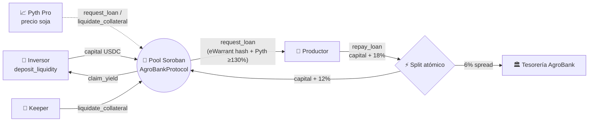

# 🌾 AgroBank Protocol

**Crédito agro on-chain para Argentina, construido sobre Stellar/Soroban.**
Inversores prestan USDC a un pool, los productores toman financiamiento respaldado por un eWarrant de soja [Decreto 640/2024], y el protocolo captura un spread transparente de tesorería del **6%**.


-blue)


> ⚠️ **Estado del proyecto:** pre-alpha de hackathon. El código no fue auditado y **no debe usarse con fondos reales** hasta completar auditoría externa y revisión legal/regulatoria (ver [Contexto legal](#️-contexto-legal-argentino) y [Roadmap](#️-roadmap)).

---

## 📑 Índice

1. [Qué es AgroBank](#-qué-es-agrobank)
2. [Modelo económico: spread del 6%](#-modelo-económico-spread-del-6)
3. [API del contrato](#-api-del-contrato)
4. [Stack tecnológico](#-stack-tecnológico)
5. [Contexto legal argentino](#️-contexto-legal-argentino)
6. [Comparativa en Stellar](#-comparativa-con-la-competencia-en-stellar)
7. [Primeros pasos y tests](#-primeros-pasos)
8. [Guía de Stellar CLI (Testnet)](#-guía-de-stellar-cli-testnet)
9. [Capa off-chain (Supabase)](#️-capa-off-chain-supabase)
10. [Riesgos y limitaciones](#️-riesgos-y-limitaciones-conocidas)
11. [Roadmap](#️-roadmap)

---

## 🌱 Qué es AgroBank

AgroBank conecta dos puntas mal servidas:

- **Inversores** que buscan rendimiento en dólares digitales respaldado por activos reales.
- **Productores agropecuarios** que necesitan capital de trabajo y hoy acceden a crédito caro o lento.

El colateral es la producción misma: un **eWarrant** (warrant electrónico) [Decreto 640/2024] cuyo **hash SHA-256** queda bloqueado on-chain, valuado con el precio de la soja de **Pyth Pro** y exigido en una **sobre-colateralización mínima del 130%**.



---

## 💸 Modelo económico: spread del 6%

Parámetros definidos como constantes en `contracts/agrobank-protocol/src/lib.rs` (TNA, en puntos básicos):

```rust
pub const BPS_DENOM: i128 = 10_000;
pub const ACTIVE_RATE_BPS: u32 = 1_800;   // 18% — paga el productor
pub const PASSIVE_RATE_BPS: u32 = 1_200;  // 12% — cobran los inversores
pub const TREASURY_SPREAD_BPS: u32 = ACTIVE_RATE_BPS - PASSIVE_RATE_BPS; // 6%
pub const MIN_COLLATERAL_RATIO_BPS: i128 = 13_000; // 130%
pub const LEDGERS_PER_YEAR: i128 = 365 * 17_280;   // 6.307.200
```

> **Identidad contable:** `18% (productor) − 12% (inversores) = 6% (tesorería)`.

**Cómo se devenga el interés:** sobre el plazo pactado, `expiry_ledger − start_ledger`, prorrateado a 365 días:

```
interés = principal × tasa_bps × plazo_ledgers / (10_000 × 6_307_200)
```

El spread se calcula **por resta** (`interés_activo − interés_pasivo`), por lo que `inversores + tesorería = interés total` siempre, sin polvo perdido.

### Ejemplo verificado por tests (principal 10.000 USDC, plazo 365 días)

| Concepto | Cálculo | USDC | Unidades (7 dec.) |
|---|---|---:|---:|
| Principal | — | 10.000 | 100.000.000.000 |
| Interés total (18%) | 10.000 × 18% | 1.800 | 18.000.000.000 |
| → Inversores (12%) | 10.000 × 12% | 1.200 | 12.000.000.000 |
| → Tesorería (6%) | 1.800 − 1.200 | 600 | 6.000.000.000 |
| **El productor paga** | 10.000 + 1.800 | **11.800** | 118.000.000.000 |
| → al pool (`capital + 12%`) | 10.000 + 1.200 | 11.200 | 112.000.000.000 |
| → a la tesorería (`6%`) | — | 600 | 6.000.000.000 |

Para un plazo de 182,5 días (`YEAR/2`) todo se divide a la mitad (9% / 6% / 3%).

**Colateral:** 50 t de soja a USD 400/t = USD 20.000 ⇒ ratio 200% ≥ 130% ✅. Con 30 t (USD 12.000) el contrato rechaza con `Undercollateralized`.

> El spread del 6% es **bruto**: de ahí salen la reserva por incumplimiento, la suscripción del oráculo, comisiones de red y costos legales/operativos. Además, solo se devenga sobre capital **efectivamente prestado**: con baja utilización del pool, el ingreso baja (ver [Riesgos](#️-riesgos-y-limitaciones-conocidas)).

---

## 🧩 API del contrato

Contrato único `AgroBankProtocol` (`contracts/agrobank-protocol/src/lib.rs`).

| Función | Auth | Qué hace |
|---|---|---|
| `initialize(admin, usdc, treasury, pyth_verifier, soy_feed_id)` | `admin` | Configura el protocolo. **Una sola vez** (`AlreadyInitialized` si se repite). |
| `deposit_liquidity(investor, amount) → i128` | `investor` | Transfiere USDC (SAC, `token::Client`), emite shares 1:1, devuelve rendimiento pendiente. |
| `withdraw_liquidity(investor, amount)` | `investor` | Retira capital **no prestado** (`amount ≤ shares` y `≤ total_shares − total_lent`). |
| `claim_yield(investor) → i128` | `investor` | Cobra intereses devengados por repagos. |
| `request_loan(farmer, principal, collateral_tonnes, expiry_ledger, e_warrant_hash, price_update) → u64` | `admin` + `farmer` | Bloquea el hash del eWarrant (sin doble pignoramiento), verifica ≥130% con Pyth y desembolsa USDC. |
| `repay_loan(farmer, loan_id)` | `farmer` | **Split atómico**: capital + 12% → pool, 6% → tesorería, en una sola transacción. |
| `liquidate_collateral(loan_id, price_update) → LoanStatus` | permisionless | Pasa a `Defaulted` si venció `expiry_ledger` o si Pyth reporta colateral < 130%. |
| `get_config()`, `get_loan(loan_id)`, `get_investor(investor)`, `pool_stats()` | — | Vistas. `pool_stats` → `(total_shares, total_lent, acc_yield_per_share)`. |

Eventos: `LiquidityDeposited`, `LiquidityWithdrawn`, `LoanOriginated`, `LoanRepaid`, `LoanDefaulted`, `YieldClaimed` y `OraclePriceUsed` (precio, exponente y timestamp de Pyth usados en cada `request_loan` o `liquidate_collateral`, para auditoría del oráculo).

Registro por préstamo (`LoanAssignment`): `farmer_address`, `principal_usd`, `start_ledger`, `expiry_ledger`, `e_warrant_hash: BytesN<32>`, `collateral_tonnes`, `interest_rate_bps` (1800), `investor_yield_bps` (1200), `status` (`Active | Repaid | Defaulted`).

---

## 🧰 Stack tecnológico

| Capa | Tecnología | Uso |
|---|---|---|
| **Contratos** | **Soroban Rust SDK v28** (`soroban-sdk = "28"`) | Pool, originación, repago con split atómico, liquidación |
| **Oráculo** | **Pyth Pro** (antes Pyth Lazer), modelo *pull* | Precio de la soja, verificado on-chain vía cross-contract call (`PythVerifierClient::verify_update`) |
| **Contexto de desarrollo con IA** | **Stellar Raven MCP** | Consulta de docs y capacidades vigentes de Stellar |
| **Tooling** | Stellar CLI, `cargo`, `wasm32v1-none` | Build, tests y deploy |

**Integración con Pyth Pro.** El contrato consume el verificador mediante el adaptador `PythVerifierInterface { verify_update(env, update: Bytes) -> VerifiedPrice }` y valida: feed correcto (`soy_feed_id`), precio > 0, antigüedad ≤ 60 s (`MAX_PRICE_AGE_SECS`) y que el timestamp no sea futuro.

> ⚠️ **A confirmar antes de mainnet:** (1) la firma real del verificador de Pyth Pro en Stellar y el ID de su contrato en Testnet; (2) que exista un *feed* de soja en el catálogo de Price Feed IDs de Pyth, con su liquidez y horario. Si la firma difiere, solo cambian `PythVerifierInterface` y `read_soy_price`; el resto del contrato no se toca. Suscripción con `formats: ["leEcdsa"]` (requerido para Stellar). Docs: <https://docs.pyth.network/price-feeds/pro/integrate-as-consumer/stellar>

> **Stellar Raven** es una capa de **contexto**, no un auditor de seguridad: complementa, pero no reemplaza, una auditoría formal.

---

## ⚖️ Contexto legal argentino

| Norma | Qué establece |
|---|---|
| **Ley 9.643** (1914) | Régimen histórico de warrants y certificados de depósito. |
| **Disposiciones 76/2019 y 30/2021** (Subsecretaría de Mercados Agropecuarios) | Primeros pasos hacia la digitalización de warrants (*eWarrants*). |
| **DNU 70/2023** | Reforma la Ley 9.643, incluyendo warrants sobre animales vivos. |
| **Decreto 640/2024** (18/07/2024) | Reglamenta el DNU 70/2023: warrants de **libre emisión**, sin obligación de inscribirse en el Registro de Warranteras, con emisión y negociación **electrónica** en plataformas propias o de terceros, públicas o privadas. |

**Relevancia para AgroBank:** el Decreto 640/2024 habilita técnicamente representar y circular el colateral sobre registros distribuidos. En el contrato, `e_warrant_hash` (SHA-256 del eWarrant) queda bloqueado en `request_loan` y `DataKey::Warrant(hash)` impide pignorarlo dos veces. Un hash on-chain **no reemplaza por sí solo** la validez jurídica del warrant: la plataforma debe conservar el eWarrant y coordinar su ejecución física con el depositario. Por eso `liquidate_collateral` **solo cambia el estado a `Defaulted`**: la ejecución del grano ocurre off-chain.

### Precedente local de tokenización agro

**Biotoken** es una empresa argentina que nació en bioinsumos y hoy tokeniza reducciones de carbono en el agro con tecnología blockchain, con revisiones periódicas de cada cultivo tokenizado. Sirve como **antecedente de viabilidad de tokenización agropecuaria en el país**.

<!-- TODO (antes de publicar): confirmar con fuente primaria el vínculo Biotoken–INTA y si existe un caso de warrant tokenizado. No afirmar el convenio hasta tenerlo documentado. -->

### Salvedades regulatorias

- Captar fondos del público puede activar regímenes de la **CNV** y de prevención de lavado (**UIF**), incluyendo el tratamiento de proveedores de servicios de activos virtuales.
- La estructura jurídica del pool, la ejecución del warrant ante mora y la custodia física de la mercadería requieren **asesoramiento legal especializado**.

> Este documento es informativo y **no constituye asesoramiento legal ni financiero**.

---

## 🥊 Comparativa con la competencia en Stellar

| Criterio | **AgroBank Protocol** | **Blend Protocol** | **Centrifuge** (deRWA en Stellar) |
|---|---|---|---|
| **Qué es** | Crédito agro originado contra eWarrants | Pools de préstamo aislados y permisionless | Tokenización de activos reales (RWA) |
| **Enfoque** | Agro argentino, colateral = producción | Genérico | Activos institucionales (bonos del Tesoro de EE.UU., CLOs) |
| **Presencia en Stellar** | Nativo (Soroban) | Nativo (Soroban) | Productos deRWA vía estándar OFT de LayerZero |
| **Marco legal local** | Ley 9.643 y Decreto 640/2024 | No específico de Argentina | No específico de Argentina |
| **Diferencial** | Spread transparente de 6% y colateral agro local | Flexibilidad | Productos regulados de EE.UU. |

> **Lectura honesta:** Blend es infraestructura sobre la que también podría construirse un pool agro. La ventaja de AgroBank es de **nicho y marco legal local**, no de tecnología base.

---

## 🚀 Primeros pasos

### Requisitos

- Rust **1.91+** (requerido por `soroban-sdk` 28) y target `wasm32v1-none`
- [Stellar CLI](https://developers.stellar.org/docs/tools/cli)
- Cuenta de testnet fondeada (la crea `stellar keys generate --fund`)

### Estructura del repositorio

```text
agrobank-protocol/
├── Cargo.toml                         # workspace (members = ["contracts/*"])
├── contracts/agrobank-protocol/
│   ├── Cargo.toml                     # crate cdylib (nombre: agrobank-protocol)
│   └── src/lib.rs                     # contrato único (lib + tests)
├── supabase/migrations/               # esquema off-chain
├── index.html                         # dashboard (prototipo simulado)
└── README.md
```

### Build y tests

```bash
rustup target add wasm32v1-none
cargo test                 # 8 tests: split 18/12/6, ratio 130%, ciclo completo, liquidación
stellar contract build     # → target/wasm32v1-none/release/agrobank_protocol.wasm
```

Los tests incluyen un **Pyth simulado** (`MockPyth`) y un USDC SAC de prueba, y cubren: `initialize` una sola vez, ciclo `deposit_liquidity → request_loan → repay_loan → claim_yield → withdraw_liquidity`, rechazo de doble pignoramiento, de sub-colateralización y de sobre-préstamo, y `liquidate_collateral` por precio y por vencimiento.

---

## 🧪 Guía de Stellar CLI (Testnet)

Todos los nombres de funciones y parámetros coinciden **1:1** con `contracts/agrobank-protocol/src/lib.rs`. Los montos están en unidades de 7 decimales (`1 USDC = 10_000_000`).

### 0. Billeteras (mapeo de roles)

| Identidad CLI | Rol en el contrato |
|---|---|
| `agro-admin` | `admin` (firma `initialize` y `request_loan`) |
| `usdc-issuer` | Emisor del USDC de prueba |
| `agro-treasury` | `treasury` (recibe el 6% de spread) |
| `agro-investor` | `investor` |
| `agro-farmer` | `farmer` |

```bash
for k in agro-admin usdc-issuer agro-treasury agro-investor agro-farmer; do
  stellar keys generate --global $k --network testnet --fund
done

ADMIN=$(stellar keys address agro-admin)
ISSUER=$(stellar keys address usdc-issuer)
TREASURY=$(stellar keys address agro-treasury)
INVESTOR=$(stellar keys address agro-investor)
FARMER=$(stellar keys address agro-farmer)
```

### 1. USDC de prueba (SAC) y saldos

```bash
# Contrato SAC del USDC de prueba
USDC=$(stellar contract asset deploy \
  --asset USDC:$ISSUER --source usdc-issuer --network testnet)

# Trustlines (cuentas clásicas que reciben USDC)
for k in agro-treasury agro-investor agro-farmer; do
  stellar tx new change-trust --line USDC:$ISSUER --source $k --network testnet
done

# Fondeo: 100.000 USDC al inversor, 20.000 al productor (para pagar intereses)
stellar tx new payment --source usdc-issuer --destination $INVESTOR \
  --asset USDC:$ISSUER --amount 1000000000000 --network testnet
stellar tx new payment --source usdc-issuer --destination $FARMER \
  --asset USDC:$ISSUER --amount 200000000000 --network testnet
```

> **Demo de una sola firma:** si vas a usar `FARMER=$ADMIN` (ver paso 5), `agro-admin` también necesita trustline y fondos de USDC. Repetí `change-trust` y el `payment` de 20.000 USDC para `agro-admin`.

### 2. Build y deploy

```bash
stellar contract build

BANK=$(stellar contract deploy \
  --wasm target/wasm32v1-none/release/agrobank_protocol.wasm \
  --source agro-admin --network testnet --alias agrobank)
echo $BANK
```

### 3. `initialize(admin, usdc, treasury, pyth_verifier, soy_feed_id)`

```bash
# Completar con los valores oficiales de Pyth Pro (ver "A confirmar" arriba)
PYTH_VERIFIER=<C...contrato verificador de Pyth Pro en Testnet>
SOY_FEED_ID=<feed id u32 de la soja>

stellar contract invoke --id $BANK --source agro-admin --network testnet -- \
  initialize \
  --admin $ADMIN \
  --usdc $USDC \
  --treasury $TREASURY \
  --pyth_verifier $PYTH_VERIFIER \
  --soy_feed_id $SOY_FEED_ID

# Ejecutar justo después del deploy y verificar que el admin sea el esperado:
stellar contract invoke --id $BANK --source agro-admin --network testnet -- get_config
```

### 4. `deposit_liquidity(investor, amount)`

```bash
# 20.000 USDC
stellar contract invoke --id $BANK --source agro-investor --network testnet -- \
  deposit_liquidity --investor $INVESTOR --amount 200000000000

stellar contract invoke --id $BANK --source agro-investor --network testnet -- pool_stats
# → [200000000000, 0, 0]   (total_shares, total_lent, acc_yield_per_share)
```

### 5. `request_loan(farmer, principal, collateral_tonnes, expiry_ledger, e_warrant_hash, price_update)`

```bash
PRINCIPAL=100000000000                 # 10.000 USDC
TONNES=50                              # 50 t × USD 400 = USD 20.000 (ratio 200% ≥ 130%)
LEDGER_NOW=<ledger actual, ver explorador de testnet>
EXPIRY=$((LEDGER_NOW + 6307200))       # ≈ 365 días; start_ledger es el ledger de la tx, así que los montos serán levemente menores a la tabla
WARRANT_HASH=$(printf 'eWarrant-640-2024-0001' | sha256sum | cut -d' ' -f1)  # BytesN<32>
PYTH_UPDATE_HEX=<payload leEcdsa firmado de Pyth Pro, en hexadecimal>
```

`request_loan` exige **dos autorizaciones** (`admin` y `farmer`) y la CLI solo firma por la cuenta `--source`. Con `--source agro-farmer` la tx falla por falta de la autorización del admin.

**Demo rápido (una sola firma):** el admin actúa también como productor. Definí `FARMER=$ADMIN` y usá `--source agro-admin` en los pasos 5 y 6.

```bash
FARMER=$ADMIN
stellar contract invoke --id $BANK --source agro-admin --network testnet -- \
  request_loan \
  --farmer $FARMER \
  --principal $PRINCIPAL \
  --collateral_tonnes $TONNES \
  --expiry_ledger $EXPIRY \
  --e_warrant_hash $WARRANT_HASH \
  --price_update $PYTH_UPDATE_HEX
# → 0   (loan_id)
```

Para roles separados hay que firmar la entrada de autorización del admin por separado (`--build-only` → `stellar tx simulate` → firmas → `stellar tx send`; ver `stellar tx sign --help`).

Repetir el mismo `--e_warrant_hash` falla con `WarrantAlreadyPledged` (#8). Sub-colateralizado falla con `Undercollateralized` (#10).

### 6. `repay_loan(farmer, loan_id)` — Split Atómico

> Si usaste el demo de una sola firma, reemplazá `--source agro-farmer` por `--source agro-admin`.

```bash
stellar contract invoke --id $BANK --source agro-farmer --network testnet -- \
  repay_loan --farmer $FARMER --loan_id 0
```

En **una sola transacción**, desde la billetera del productor:

| Destino | Monto (plazo 365 d exactos, como en los tests) |
|---|---:|
| Pool (`$BANK`): capital + 12% | 11.200 USDC (`112000000000`) |
| Tesorería (`$TREASURY`): 6% | 600 USDC (`6000000000`) |
| **Total pagado por el productor** | **11.800 USDC** |

Si cualquiera de las dos transferencias falla, se revierte todo.

### 7. `claim_yield(investor)` y `withdraw_liquidity(investor, amount)`

```bash
stellar contract invoke --id $BANK --source agro-investor --network testnet -- \
  claim_yield --investor $INVESTOR
# → ~12000000000 (1.200 USDC; hasta 1 unidad de polvo por redondeo)

stellar contract invoke --id $BANK --source agro-investor --network testnet -- \
  withdraw_liquidity --investor $INVESTOR --amount 200000000000
```

### 8. `liquidate_collateral(loan_id, price_update)`

Permisionless: cualquier *keeper* puede invocarla. Requiere un préstamo `Active`: el `loan_id 0` ya fue repagado en el paso 6 y el paso 7 retiró todo el capital, así que antes de originar el segundo préstamo hay que reponer liquidez libre:

```bash
stellar contract invoke --id $BANK --source agro-investor --network testnet -- \
  deposit_liquidity --investor $INVESTOR --amount 200000000000
```

Luego originá el 2.º préstamo (paso 5 con otro `WARRANT_HASH`; su `loan_id` será `1`). Para probar el vencimiento sin oráculo usá `EXPIRY=$((LEDGER_NOW + 20))` (≈ 100 s) y, pasado ese ledger, `--price_update 00`: por vencimiento el contrato no lee Pyth.

```bash
stellar contract invoke --id $BANK --source agro-treasury --network testnet -- \
  liquidate_collateral --loan_id 1 --price_update $PYTH_UPDATE_HEX
# → "Defaulted" si (ledger > expiry_ledger) o (valor del colateral según Pyth < 130% del principal)
# → NotLiquidatable (#11) si el préstamo está sano
```

Tras `Defaulted`, la ejecución física del eWarrant [Decreto 640/2024] se coordina off-chain con el depositario.

### Vistas

```bash
stellar contract invoke --id $BANK --network testnet -- get_loan --loan_id 0
stellar contract invoke --id $BANK --network testnet -- get_investor --investor $INVESTOR
stellar contract invoke --id $BANK --network testnet -- pool_stats
```

---

## 🗄️ Capa off-chain (Supabase)

Las migraciones en `supabase/migrations/` guardan lo que la cadena no retiene: perfiles (wallet como identidad, CUIT, KYC, score de Cartas de Porte), espejo de préstamos, documentación del eWarrant, histórico de pignoraciones del hash (`warrant_pledges`) y auditoría del oráculo (`oracle_audit`, alimentada por el evento `OraclePriceUsed`).

- **Unicidad del hash:** el contrato borra `DataKey::Warrant` al repagar, así que un mismo hash puede volver a pignorarse. En SQL la unicidad es parcial (solo `Active` y `Defaulted`), y el histórico queda en `warrant_pledges`.
- **Indexador:** `LoanRepaid` y `LoanDefaulted` no traen wallet. Completá `chain_events.wallet` con `loans.farmer` vía `loan_id`; si no, la RLS oculta esos eventos al productor.
- **RLS:** el claim `wallet` del JWT debe emitirlo tu backend tras validar SEP-10, no `user_metadata` (editable por el usuario).

---

## ⚠️ Riesgos y limitaciones conocidas

| Riesgo | Descripción | Estado / mitigación |
|---|---|---|
| **Utilización del pool** | El spread se devenga solo sobre capital prestado; con baja utilización el ingreso cae. | Modelar escenarios 40/60/80% antes de prometer rendimientos. |
| **Pérdidas por default** | Un préstamo `Defaulted` mantiene su principal en `total_lent` hasta la recuperación off-chain; el contrato **no socializa pérdidas** ni tiene fondo de reserva. | Pendiente: fondo de reserva y resolución de defaults. |
| **Oráculo** | Dato desactualizado o feed inexistente. | Chequeo de frescura (60 s), feed ID y precio > 0; adaptador aislado. |
| **Inicialización** | `initialize` es de una sola vez, pero entre el deploy y la llamada podría adelantarse un tercero. | Ejecutarla inmediatamente y verificar con `get_config`. |
| **Retiros** | Solo se retira capital no prestado. | Diseñado así para evitar corridas; ventanas de salida por definir. |
| **Legal / regulatorio** | Encuadre CNV/UIF del token de rendimiento. | Dictamen legal antes de captar fondos. |
| **Físico** | Custodia y ejecución del grano. | Depositarios habilitados y verificación periódica. |
| **TTL de storage** | `Loan` y `Warrant` extienden TTL a 60 días, pero los plazos pueden llegar a 365. Una entrada sin uso se archiva y hay que restaurarla. | Subir el TTL hasta cubrir el plazo (dentro del máximo de la red) o documentar el restore operativo. |
| **Gobernanza** | Admin único, sin rotación ni pausa. | Pendiente de diseño. |
| **Contrato** | No auditado. | Auditoría externa y despliegue gradual con topes. |

---

## 🛣️ Roadmap

- [x] Contrato único: `initialize`, `deposit_liquidity`, `withdraw_liquidity`, `claim_yield`, `request_loan`, `repay_loan`, `liquidate_collateral`
- [x] Tests de lógica y de ciclo completo con Pyth simulado
- [ ] Confirmar verificador y feed de soja de Pyth Pro en Testnet
- [ ] Fondo de reserva y resolución de defaults
- [ ] Registro de eWarrants con depositarios reales
- [ ] Revisión legal y encuadre regulatorio (CNV/UIF)
- [ ] Auditoría externa
- [ ] Piloto en mainnet con topes bajos

---

## 🤝 Contribuir y licencia

Abrí un *issue* para discutir cambios grandes antes de enviar un *pull request*. Distribuido bajo licencia **MIT** (ver `LICENSE`).

<sub>AgroBank Protocol es software experimental. Nada en este repositorio constituye oferta de inversión, asesoramiento financiero ni legal.</sub>
