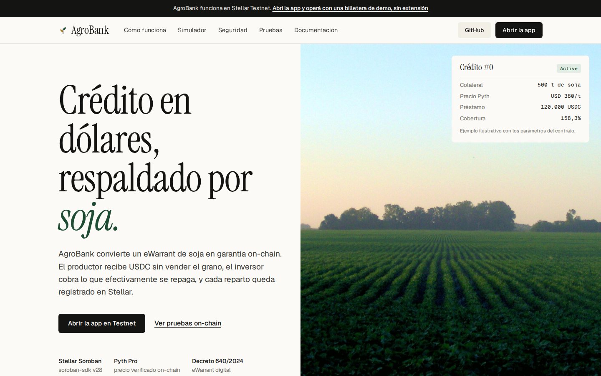
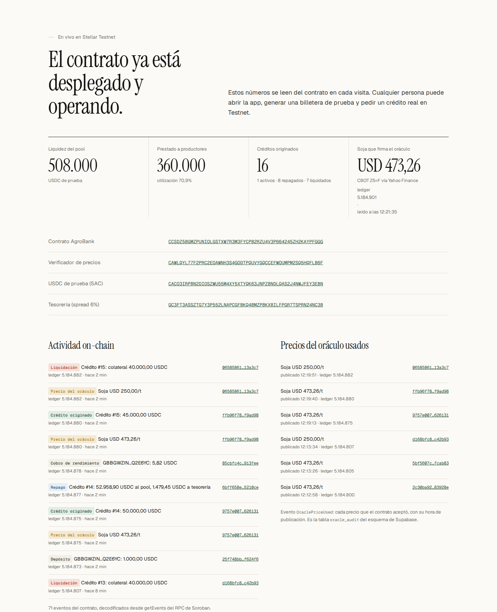
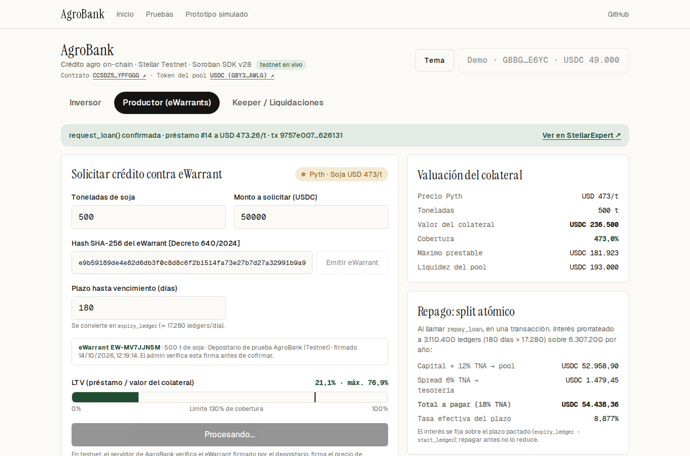
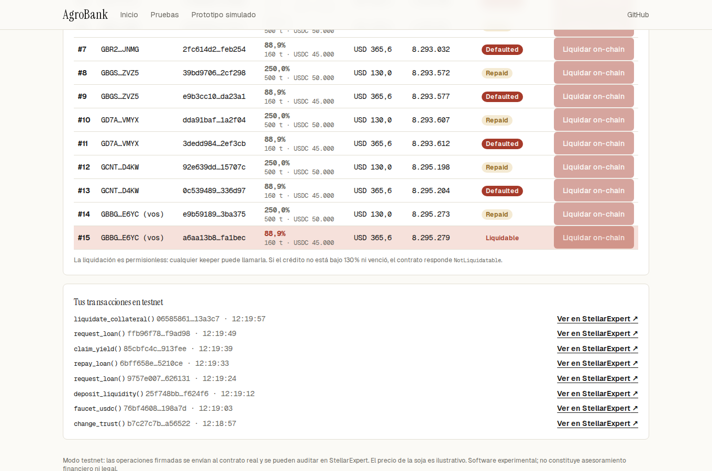
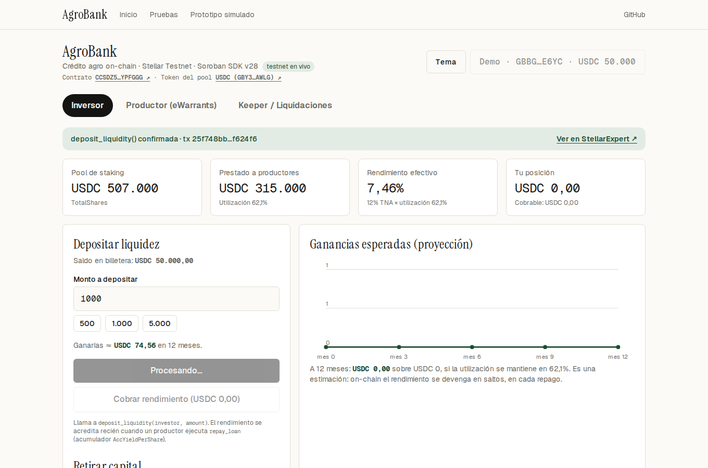
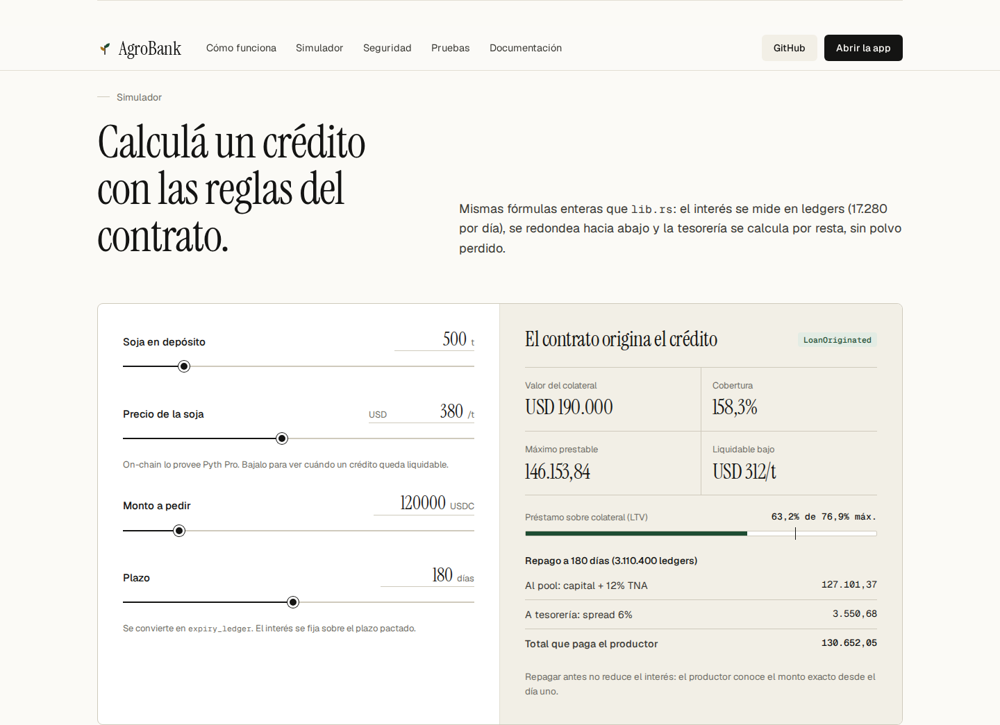
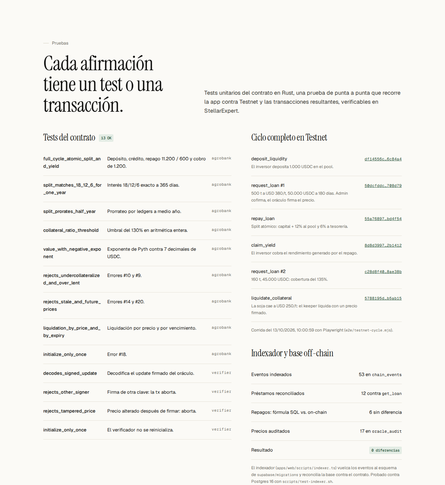

# 🌾 AgroBank Protocol

**Crédito agrícola on-chain para Argentina: USDC contra eWarrants de soja, sobre Stellar Soroban.**


| | |
|---|---|
| 🌐 **Sitio** | <https://agro-bank.vercel.app> |
| 🧪 **App en Testnet** | <https://agro-bank.vercel.app/app> (botón **Billetera de demo**: sin extensión) |
| 🔎 **Pruebas on-chain** | <https://agro-bank.vercel.app/#pruebas> y la [tabla de abajo](#-pruebas-en-testnet) |
| 🎞️ **Prototipo simulado** | <https://agro-bank.vercel.app/demo> |

```bash
git clone https://github.com/psyduckLabs/agrobank-protocol.git
```

---

## 📸 Capturas

| Landing | Estado en vivo del contrato |
|---|---|
|  |  |

| Crédito originado en Testnet (cofirma del admin + precio firmado) | Liquidación on-chain por caída del precio |
|---|---|
|  |  |

| Inversor: depósito en el pool real | Simulador con las fórmulas del contrato |
|---|---|
|  |  |

| Pruebas en la página: tests, ciclo en Testnet e indexador |
|---|
|  |

Las capturas las genera la prueba E2E (`e2e/testnet-cycle.mjs`) recorriendo el sitio publicado.

---

## ✅ Pruebas en Testnet

Corrida E2E del 14/10/2026 contra `https://agro-bank.vercel.app`, con una billetera de demo nueva. Cada fila es una transacción real en Stellar Testnet:

| Paso | Qué prueba | Transacción |
|---|---|---|
| `deposit_liquidity` | El inversor deposita 1.000 USDC en el pool. | [25f748bb…f624f6](https://stellar.expert/explorer/testnet/tx/25f748bbba08a91dce7ee7ba67bbf1f6922189fd0f28b387a23e54dffff624f6) |
| `request_loan` | El depositario emite un eWarrant firmado por 500 t; el admin verifica la firma y cofirma; el oráculo firma el precio de mercado (futuro CBOT, ~USD 470/t); el contrato verifica la firma on-chain. 50.000 USDC a 180 días. | [9757e007…626131](https://stellar.expert/explorer/testnet/tx/9757e00765611d2b68aadbf13619c0cf5450b076d3ee07e5b6ef751f5e626131) |
| `repay_loan` | Split atómico: capital + 12% al pool y 6% a tesorería en la misma transacción. | [6bff658e…5210ce](https://stellar.expert/explorer/testnet/tx/6bff658e0729c6acd1149b3de350e7ab15e42e23f2949373b3cd9fa7bb5210ce) |
| `claim_yield` | El inversor cobra el rendimiento que generó el repago. | [85cbfc4c…913fee](https://stellar.expert/explorer/testnet/tx/85cbfc4ccc799aabac9417df28ee12af4537dc70160dac7e97729e2db1913fee) |
| `request_loan` | 160 t, 45.000 USDC: unos 168% de cobertura al precio de mercado. | [ffb96f78…f9ad98](https://stellar.expert/explorer/testnet/tx/ffb96f78639679d39fe9480c01e28c9f53e9b8099499c91d35d1033712f9ad98) |
| `liquidate_collateral` | La soja cae a USD 250/t: el keeper envía un precio firmado y el crédito pasa a `Defaulted`. | [06585861…13a3c7](https://stellar.expert/explorer/testnet/tx/0658586190600030ef5481c8ce70e8936965e836ea80eceb29b03d524713a3c7) |
| atestación | Un pedido con un hash sin certificado del depositario: el admin no cofirma (HTTP 400). | sin tx, rechazado antes de firmar |

Detalle completo de la corrida: [`docs/e2e-proofs.json`](docs/e2e-proofs.json).

### Contratos desplegados

| | Dirección |
|---|---|
| AgroBank | [`CCSDZ5BGMZPUNIOLGSTXW7R3M3FYCPB2RZU4V3P664245ZH2KAYPFGGG`](https://stellar.expert/explorer/testnet/contract/CCSDZ5BGMZPUNIOLGSTXW7R3M3FYCPB2RZU4V3P664245ZH2KAYPFGGG) |
| Verificador de precios | [`CAWLQYL77F2PRC2EOAWNH3S4GODTPQUVYGQCCEFWOUMPM2SQ5HQFLB6F`](https://stellar.expert/explorer/testnet/contract/CAWLQYL77F2PRC2EOAWNH3S4GODTPQUVYGQCCEFWOUMPM2SQ5HQFLB6F) |
| USDC de prueba (SAC) | [`CACO3IRPBN2DIOSZWU55M4XY5XTYQK63JNPZBNDLQAS2J4NWJFEY3EBN`](https://stellar.expert/explorer/testnet/contract/CACO3IRPBN2DIOSZWU55M4XY5XTYQK63JNPZBNDLQAS2J4NWJFEY3EBN) |
| Tesorería | [`GC3FT3ASSZTG7Y3P552LNAPCGFBKQ4BMZPBKXBILFPGR7TSPRN24NC3B`](https://stellar.expert/explorer/testnet/account/GC3FT3ASSZTG7Y3P552LNAPCGFBKQ4BMZPBKXBILFPGR7TSPRN24NC3B) |

Fuente de verdad: [`deployments/testnet.json`](deployments/testnet.json). Se regenera con `scripts/deploy-testnet.sh`.

### Tests del contrato (13 OK)

```bash
cargo test
# agrobank-protocol: 9 passed  ·  price-verifier: 4 passed
```

### Indexador y Supabase: reconciliación sin diferencias

`apps/web/scripts/indexer.ts` lee los eventos del contrato con `getEvents` y los vuelca al esquema de [`supabase/migrations`](supabase/migrations) (`chain_events`, `loans`, `warrant_pledges`, `oracle_audit`, `pool_snapshots`, `indexer_state`). Después reconcilia la base contra el contrato:

| Chequeo | Resultado |
|---|---|
| Migraciones aplicadas sobre Postgres 16 | ✅ las dos, sin errores |
| Eventos indexados (segunda corrida idempotente) | 35, luego 0 |
| Préstamos de la base vs. `get_loan` on-chain | 8 sin diferencias |
| Repagos: vista SQL `loan_repayment_quotes` vs. `LoanRepaid` on-chain | 4 sin diferencias (la fórmula SQL da al stroop lo que transfirió el contrato) |
| `total_lent` de la base vs. `pool_stats` | igual |
| Precios en `oracle_audit` | 11 |

```bash
pnpm indexer:test     # Postgres en Docker + migraciones + indexador + reconciliación
# con Supabase real: DATABASE_URL=<connection string> node apps/web/scripts/indexer.ts
```

Reporte: [`docs/indexer-reconciliation.json`](docs/indexer-reconciliation.json). La landing muestra la actividad on-chain (`/api/events`) y este resultado.

### CI

[`.github/workflows/ci.yml`](.github/workflows/ci.yml) corre en cada PR: `cargo test`, build de la web, migraciones de Supabase sobre Postgres y el indexador contra Testnet con reconciliación.

---

## 🔌 Cómo funciona en Testnet

```
Navegador (/app)                    Vercel (route handlers)                 Stellar Testnet
─────────────────                   ───────────────────────                 ───────────────
Billetera de demo o Freighter ──►  POST /api/faucet  ─ emisor USDC ──────►  payment USDC
                                    GET  /api/price   ─ oráculo firma ed25519 sobre el precio
Productor pide crédito ─────────►  POST /api/loan    ─ valida topes, firma precio,
                                                       simula y cofirma como admin
Productor firma el sobre ───────────────────────────────────────────────►  request_loan
                                                                            └► price-verifier.verify_update
Keeper liquida ─► /api/price?px= ───────────────────────────────────────►  liquidate_collateral
                                    GET  /api/status  ─ lectura del pool para la landing
```

| Pieza | Dónde | Qué hace |
|---|---|---|
| **Verificador de precios** | `contracts/price-verifier` | Imita el modelo pull de Pyth: recibe `feed_id │ price │ exponent │ publish_time_us` + firma ed25519 y la valida con `env.crypto().ed25519_verify`. Misma interfaz `verify_update(Bytes) -> VerifiedPrice` que espera AgroBank, así que migrar a Pyth Lazer solo cambia la dirección del verificador. |
| **Cofirma del admin** | `apps/web/src/app/api/loan` | El servidor arma `request_loan`, firma la entrada de autorización del admin (`signAuthEntries`) y devuelve el XDR; el productor firma el sobre con su billetera. Las dos `require_auth` del contrato se cumplen de verdad. |
| **Oráculo** | `apps/web/src/app/api/price` | Firma el **precio de mercado de la soja**: futuro de CBOT (ZS=F) convertido a USD/t, con cache de 5 minutos y caída al precio de referencia si la fuente no responde. Updates frescos (menos de 60 s, como exige `read_soy_price`). `?px=` simula un movimiento de mercado para probar liquidaciones. |
| **Atestación del eWarrant** | `apps/web/src/app/api/ewarrant` · `src/lib/ewarrant.ts` | El depositario de Testnet emite un certificado (productor, grano, toneladas) firmado con ed25519. El hash que se pignora on-chain es el SHA-256 del certificado, y antes de cofirmar el admin verifica la firma, el titular y que las toneladas no superen lo certificado. |
| **Faucet** | `apps/web/src/app/api/faucet` | El emisor del USDC de prueba envía 50.000 USDC a cuentas con trustline. |
| **Billetera de demo** | `apps/web/src/lib/chain.ts` | Genera una clave de Testnet en el navegador, la fondea con Friendbot, crea la trustline y pide USDC. Sin extensión. También funcionan Freighter, xBull, Albedo y Lobstr vía Stellar Wallets Kit. |

| **Indexador** | `apps/web/scripts/indexer.ts` · `/api/events` | Eventos del contrato al esquema de Supabase, con reconciliación; la landing muestra la actividad y los precios usados. |

**Estado de Pyth:** el contrato ya habla la interfaz del verificador de Pyth Pro (`verify_update`). Para Testnet usamos un verificador propio porque Pyth Pro requiere una suscripción con token y todavía no confirmamos un feed de soja en Stellar ([docs](https://docs.pyth.network/price-feeds/pro/integrate-as-consumer/stellar)). Pasar a Pyth es desplegar con `pyth_verifier` apuntando al contrato oficial y adaptar `read_soy_price` al payload `leEcdsa`.

Las claves del admin, del oráculo, del depositario y del emisor son **solo de Testnet** y viven como variables de entorno del servidor (`AGROBANK_ADMIN_SECRET`, `AGROBANK_ORACLE_SECRET`, `DEPOSITARIO_SECRET`, `USDC_ISSUER_SECRET`).

---

## 🎯 Problema → Solución

| | Hoy en el agro argentino | Con AgroBank |
|---|---|---|
| **Acceso al crédito** | Tasas altas en pesos y garantías lentas de ejecutar. | Crédito en USDC respaldado por soja almacenada. |
| **Garantía** | Warrant en papel, con un circuito de warranteras. | eWarrant digital [Decreto 640/2024] bloqueado on-chain por hash. |
| **Fondeo** | Bancos e intermediarios cerrados. | Pool abierto de inversores con rendimiento del 12% TNA. |
| **Transparencia** | Spread opaco. | Spread del 6% visible y separado en la misma transacción del repago. |
| **Riesgo de precio** | Tasaciones manuales. | Precio firmado verificado on-chain, con antigüedad máxima de 60 s. |

- **Productor:** pide USDC contra un eWarrant con colateral mínimo del **130%**.
- **Inversor:** deposita USDC y cobra el **12% TNA** de los intereses repagados.
- **Tesorería:** recibe el **6%** de spread en la misma transacción del repago.
- **Keeper:** liquida sin permisos si el préstamo vence o el colateral cae bajo el 130%.

---

## 🗂️ Arquitectura del repositorio

```
agrobank-protocol/
├── contracts/
│   ├── agrobank-protocol/      # contrato core + 9 tests con MockPyth
│   └── price-verifier/         # verificador ed25519 de precios para Testnet + 4 tests
├── packages/
│   └── agrobank-client/        # bindings TypeScript generados (@agrobank/client)
├── apps/
│   └── web/                    # Next.js: landing (/), app (/app), prototipo (/demo) y API
│       ├── src/app/api/        # faucet · price · loan · status · events
│       └── scripts/indexer.ts  # indexador de eventos → Supabase + reconciliación
├── deployments/testnet.json    # direcciones desplegadas
├── e2e/testnet-cycle.mjs       # prueba E2E con Playwright contra Testnet
├── scripts/deploy-testnet.sh   # despliegue completo en Testnet
├── supabase/migrations/        # esquema off-chain + alineación ledgers/bps (RLS)
├── docs/                       # documentación, capturas y pruebas
└── index.html                  # prototipo simulado (también en /demo)
```

---

## ⚡ Inicio rápido

**Requisitos:** Node 18+, pnpm, Rust con target `wasm32v1-none` y Stellar CLI.

```bash
pnpm install
cargo test                          # 13 tests
bash scripts/deploy-testnet.sh      # opcional: despliegue propio en Testnet

cd apps/web
cp .env.example .env.local          # completar con deployments/testnet.json y claves de Testnet
pnpm dev                            # http://localhost:3000 (landing) y /app

# E2E contra un sitio (local o publicado)
BASE_URL=https://agro-bank.vercel.app node e2e/testnet-cycle.mjs
```

---

## 📚 Documentación detallada

| Documento | Contenido |
|---|---|
| [Arquitectura y tokenómica](docs/architecture_and_tokenomics.md) | Spread de 18/12/6, cálculo por ledgers, reparto del rendimiento y ciclo de vida de los métodos. |
| [Oráculo y marco legal](docs/oracle_and_legal_framework.md) | Pyth Pro (pull, leEcdsa, frescura, exponente) y el Decreto 640/2024 aplicado al estado `Defaulted`. |
| [Auditoría y roadmap](docs/audit_and_roadmap.md) | Hallazgos de consistencia corregidos, riesgos abiertos y pasos hacia producción. |
| [Guía Stellar CLI (Testnet)](docs/testnet_cli_guide.md) | Deploy, `initialize` y cada llamada con comandos listos. |

---

## 🧱 Stack

| Capa | Tecnología |
|---|---|
| Contrato | Rust · `soroban-sdk = "28"` · `wasm32v1-none` |
| Activo | USDC de prueba (Stellar Asset Contract, 7 decimales) |
| Oráculo | Verificador ed25519 en Testnet, con la interfaz de Pyth Pro (modelo pull) |
| Web | Next.js 16 · Stellar Wallets Kit · route handlers en Vercel |
| Off-chain | Supabase Postgres con RLS |

---

<sub>© 2026 Romi · psyduckLabs · MIT. Software experimental sin auditar, desplegado solo en Testnet; nada de esto es oferta de inversión ni asesoramiento legal o financiero. Fotos de la landing: Wikimedia Commons (Alfonso, Darliton, Clasonsf; CC BY-SA).</sub>
