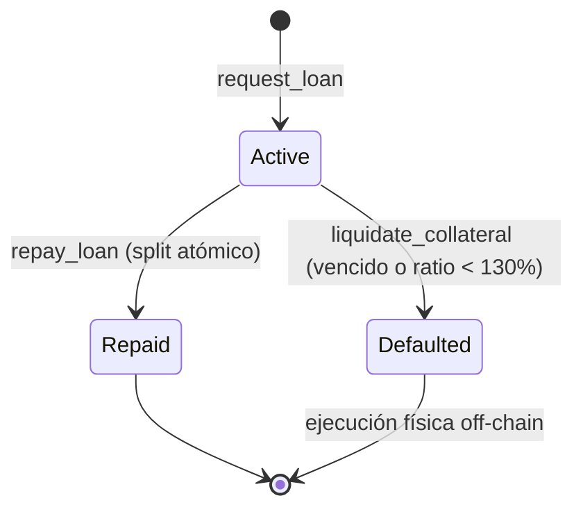

# Arquitectura y tokenómica

> Fuente de verdad: `contracts/agrobank-protocol/src/lib.rs` (soroban-sdk v28).

## 1. Parámetros del protocolo

```rust
pub const BPS_DENOM: i128 = 10_000;
pub const ACTIVE_RATE_BPS: u32 = 1_800;          // 18% TNA — paga el productor
pub const PASSIVE_RATE_BPS: u32 = 1_200;         // 12% TNA — cobra el inversor
pub const TREASURY_SPREAD_BPS: u32 = ACTIVE_RATE_BPS - PASSIVE_RATE_BPS; // 6%
pub const MIN_COLLATERAL_RATIO_BPS: i128 = 13_000; // 130%
pub const DAY_IN_LEDGERS: u32 = 17_280;          // ~5 s por ledger
pub const LEDGERS_PER_YEAR: i128 = 365 * DAY_IN_LEDGERS as i128; // 6.307.200
pub const USDC_DECIMALS: i32 = 7;
```

## 2. Modelo económico: spread del 6%

### 2.1 Fórmula

El interés se mide en **ledgers**, no en días calendario:

```
plazo_ledgers = expiry_ledger − start_ledger
interés(tasa) = ⌊ principal × tasa_bps × plazo_ledgers / (10_000 × 6_307_200) ⌋
```

| Componente | Cálculo | Destino |
|---|---|---|
| Interés total | `interés(1800)` | Lo paga el productor. |
| Interés de inversores | `interés(1200)` | Va al pool junto con el capital. |
| Spread de tesorería | `total − inversores` | Va a la billetera `treasury`. |

- El spread se calcula **por resta**, así que `inversores + tesorería = total` sin polvo perdido.
- Las tasas quedan guardadas en cada préstamo (`interest_rate_bps`, `investor_yield_bps`) en el momento de la originación.
- `split_interest` devuelve `InvalidRate` si la tasa activa es menor que la pasiva.

### 2.2 Ejemplos (principal 10.000 USDC = `100_000_000_000` unidades)

| Plazo | Ledgers | Total (18%) | Inversores (12%) | Tesorería (6%) |
|---|---:|---:|---:|---:|
| 365 días | 6.307.200 | 1.800,0000000 | 1.200,0000000 | 600,0000000 |
| 182,5 días | 3.153.600 | 900,0000000 | 600,0000000 | 300,0000000 |
| 90 días | 1.555.200 | 443,8356164 | 295,8904109 | 147,9452055 |

- Los casos de 365 y 182,5 días están cubiertos por los tests `full_cycle_atomic_split_and_yield` y `split_prorates_half_year`.
- El de 90 días muestra el redondeo hacia abajo (floor) de la división entera.

### 2.3 Base de devengo: plazo pactado

| Situación | Efecto en el MVP |
|---|---|
| Repago anticipado | Se paga el interés de todo el plazo pactado. |
| Repago tardío (nadie liquidó) | No hay recargo: se paga lo mismo. |
| Ventaja | El productor conoce el monto exacto desde el día de originación. |
| Próximo paso | Devengar por `min(ledger_actual, expiry) − start_ledger` (ver roadmap). |

### 2.4 Reparto del rendimiento y vector JIT

**Mecanismo:** acumulador por share (patrón MasterChef).

```
acc_yield_per_share += interés_inversores × 10^12 / total_shares   // en repay_loan
pendiente(inversor)  = shares × acc / 10^12 − reward_debt
```

- 1 USDC depositado = 1 share.
- `settle_investor` cierra lo devengado antes de cada cambio de shares.
- Solo se reparte interés **efectivamente repagado**; no se promete rendimiento por adelantado.

**Vector JIT (Just-In-Time), todavía abierto:**

| Paso | Qué pasa |
|---|---|
| 1 | El atacante ve en el mempool un `repay_loan` grande. |
| 2 | Deposita justo antes y pasa a tener shares en `total_shares`. |
| 3 | El repago suma el interés al acumulador de todas las shares vigentes. |
| 4 | El capital vuelve al pool, el atacante retira y llama a `claim_yield`. |

**Defensas actuales (parciales):**

- `withdraw_liquidity` solo deja retirar capital no prestado (`total_shares − total_lent`).
- No hay rendimiento ex-ante que se pueda extraer sin un repago real.

**Mitigación de diseño (roadmap):**

| Opción | Cómo funciona | Costo |
|---|---|---|
| Devengo continuo por ledger | El acumulador crece cada ledger según `total_lent × 12%`, y no de golpe en el repago. | Un poco más de cómputo por llamada. |
| Ventana de entrada | Las shares nuevas cobran recién después de N ledgers. | Complejidad en `InvestorPosition`. |
| Snapshot por préstamo | El interés de cada préstamo va a las shares vigentes en su originación. | Más storage por préstamo. |

## 3. Colateral

```
valor_usdc = toneladas × precio × 10^(exponente + 7)      // ver oracle_and_legal_framework.md
válido si  valor_usdc × 10_000 ≥ principal × 13_000
```

| Caso | Valor | Ratio | Resultado |
|---|---:|---:|---|
| 50 t a USD 400/t, préstamo de 10.000 | 20.000 | 200% | ✅ Originado |
| 30 t a USD 400/t, préstamo de 10.000 | 12.000 | 120% | ❌ `Undercollateralized` (#10) |

## 4. Ciclo de vida de los métodos



| # | Método | Firma requerida | Validaciones | Efectos | Evento |
|---|---|---|---|---|---|
| 1 | `initialize(admin, usdc, treasury, pyth_verifier, soy_feed_id)` | `admin` | Una sola vez (`AlreadyInitialized`) | Guarda `Config` y pone contadores en 0. | — |
| 2 | `deposit_liquidity(investor, amount)` | `investor` | `amount > 0` | USDC al contrato, shares 1:1 y liquidación del devengo previo. | `LiquidityDeposited` |
| 3 | `withdraw_liquidity(investor, amount)` | `investor` | Shares propias y liquidez libre | Quema shares y devuelve USDC. | `LiquidityWithdrawn` |
| 4 | `claim_yield(investor)` | `investor` | `pending > 0` | Transfiere el rendimiento pendiente. | `YieldClaimed` |
| 5 | `request_loan(farmer, principal, tonnes, expiry_ledger, e_warrant_hash, price_update)` | `admin` + `farmer` | Expiry futuro, hash no pignorado, liquidez, Pyth y 130% | Crea `LoanAssignment`, bloquea `Warrant(hash)` y transfiere USDC al productor. | `OraclePriceUsed`, `LoanOriginated` |
| 6 | `repay_loan(farmer, loan_id)` | `farmer` | Prestatario correcto y estado `Active` | Actualiza el acumulador, pasa a `Repaid`, libera el hash y hace 2 transferencias. | `LoanRepaid` |
| 7 | `liquidate_collateral(loan_id, price_update)` | Ninguna (keeper) | `Active`, y además vencido o bajo el 130% | Pasa a `Defaulted`. | `OraclePriceUsed`*, `LoanDefaulted` |

\* Solo si el préstamo no venció: un préstamo vencido se liquida sin consultar el oráculo.

### 4.1 Repago con split atómico

```
productor ──(capital + 12%)──► contrato (pool)
productor ──(6%)─────────────► treasury
```

- Las dos transferencias salen de la billetera del productor en **una sola transacción**: si una falla, se revierte todo.
- El estado se actualiza antes de transferir (checks-effects-interactions).

### 4.2 Vistas

| Vista | Devuelve |
|---|---|
| `get_config()` | `Config` |
| `get_loan(id)` | `LoanAssignment` |
| `get_investor(addr)` | `InvestorPosition { shares, reward_debt, pending_yield }` |
| `pool_stats()` | `(total_shares, total_lent, acc_yield_per_share)` |

---

<sub>© 2026 Romi · psyduckLabs</sub>
